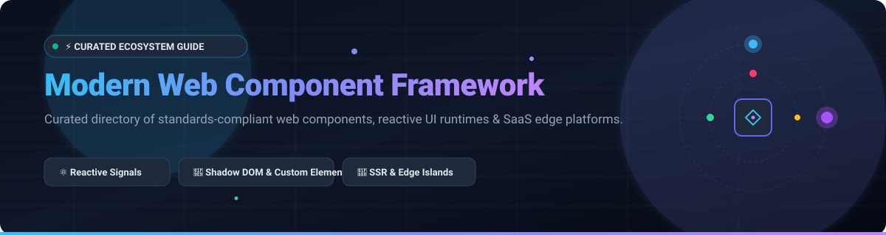

 

# ⚡ Awesome Modern Web Component Framework

### 🚀 Curated Directory of Web Components, Modern Reactive UI Frameworks & Edge Hosting Platforms

  <b>Explore standards-compliant web components, fine-grained reactive runtimes, SSR meta-frameworks, design systems, and frontend developer clouds.</b>

*Last updated: March 2026*

---

## 📑 Table of Contents
- [🌐 Sector Overview & Market Dynamics](#-sector-overview--market-dynamics)
- [☁️ SaaS & Hosted Platforms](#️-saas--hosted-platforms)
- [📦 Open-Source GitHub Projects](#-open-source-github-projects)
- [🛠️ Tooling, Bundlers & Design Systems](#️-tooling-bundlers--design-systems)
- [📈 Star History](#-star-history)
- [🤝 How to Contribute](#-how-to-contribute)
- [💖 Support](#-support)
- [⚖️ Disclaimer](#️-disclaimer)

---

## 🌐 Sector Overview & Market Dynamics

The global frontend web framework and hosting platform market is estimated at **$18.5 Billion in 2026** (expanding at an ~18.2% CAGR as cloud-native applications, serverless edge compute, and headless micro-frontends dominate enterprise software engineering). 

The market dynamics exhibit **moderate fragmentation with strong core consolidation**:
- In **hosting and edge platforms**, hyperscalers (Microsoft Azure, Amazon AWS, Google Cloud) and modern developer-experience platforms (Vercel, Cloudflare, Netlify) operate in a consolidated, winner-take-most tier.
- In **UI frameworks and component architectures**, standard-based Web Components (Custom Elements, Shadow DOM) and reactive runtime ecosystems (React, Vue, Svelte, SolidJS, Lit) remain vibrant and competitive, driving interoperability across heterogeneous enterprise technology stacks.

---

## ☁️ SaaS & Hosted Platforms

The following hosted platforms provide developer infrastructure, edge compute, automated CI/CD pipelines, and runtime hosting optimized for modern component-based frameworks. Ranked in descending order by parent company scale (Market Capitalization / Valuation):

| 🏢 Platform | 💰 Pricing (Starting Tier) | 🎁 Free Tier Limit | 📊 Company Scale (Cap / Valuation) | 📝 Description |
|:---|:---|:---|:---|:---|
| **[Azure Static Web Apps](https://azure.microsoft.com/en-us/products/app-service/static)** | **$9.00/month** per app (Standard tier) | Free forever: 3 custom domains, 0.5 GB bandwidth/month, 100 MB max app size, 20 custom staging environments. | **~$3.1 Trillion** (Microsoft Market Cap) | Microsoft cloud hosting for modern web apps with built-in serverless APIs, global CDN distribution, and GitHub Actions CI/CD workflows. |
| **[Google Firebase Hosting](https://firebase.google.com/products/hosting)** | **Pay-as-you-go** ($0.15/GB storage beyond limit, Blaze plan) | Free forever (Spark Plan): 10 GB storage, 360 MB/day (10 GB/month) data transfer, multiple custom domains, free SSL. | **~$2.1 Trillion** (Alphabet Market Cap) | Production-grade web app and micro-frontend hosting with fast global CDN, custom SSL certificates, and deep Google Cloud integration. |
| **[AWS Amplify Hosting](https://aws.amazon.com/amplify/)** | **Pay-as-you-go** ($0.01/build minute, $0.15/GB data served, $0.023/GB-month storage) | 12-Month Free Tier: 1,000 build minutes/month, 15 GB data served/month, 5 GB stored; Free forever backend core tier. | **~$1.9 Trillion** (Amazon Market Cap) | Full-stack CI/CD and edge hosting platform tailored for Next.js, React, Vue, and Angular with automated branch previews and SSR support. |
| **[Salesforce Lightning Web Components](https://developer.salesforce.com/docs/component-library/documentation/en/lwc)** | **$25.00/user/month** (Starter Suite) | 30-Day Free Trial (includes full Sales & Service Cloud environment with complete LWC runtime access); Free forever developer scratch orgs. | **~$280 Billion** (Salesforce Market Cap) | Enterprise standards-based UI component runtime built on native Web Components, reactive wire adapters, and enterprise security boundaries. |
| **[Cloudflare Pages](https://pages.cloudflare.com/)** | **$20.00/month** (Pages Pro tier) | Free forever: Unlimited bandwidth, unlimited static requests, 500 builds/month, 1 concurrent build, and free custom domains. | **~$35 Billion** (Cloudflare Market Cap) | High-performance edge deployment platform for static and SSR component frameworks integrated with Cloudflare Workers micro-VMs. |
| **[Vercel](https://vercel.com/)** | **$20.00/user/month** (Pro plan) | Free forever (Hobby Plan): 100 GB bandwidth/month, 1,000 Edge/Serverless Function GB-hours, fast global edge network, unlimited previews. | **~$3.25 Billion** (Valuation) | The creator platform of Next.js; premier frontend cloud offering zero-config edge deployments, ISR, automated previews, and speed insights. |
| **[Netlify](https://www.netlify.com/)** | **$19.00/member/month** (Pro plan) | Free forever (Starter): 100 GB bandwidth/month, 300 build minutes/month, 125,000 serverless edge requests/month, live previews. | **~$2.0 Billion** (Valuation) | Composable web platform for modern frontend frameworks with serverless edge functions, instant rollbacks, forms, and identity management. |
| **[Render](https://render.com/)** | **$19.00/user/month** (Team plan; Individual services start at $7.00/month) | Free forever: 100 GB bandwidth/month, 500 pipeline build minutes/month, automated SSL, static site hosting with custom domains. | **~$500 Million** (Valuation) | Unified developer cloud for deploying modern frontend static assets, SSR containers, background workers, and PostgreSQL databases. |
| **[Fly.io](https://fly.io/)** | **Usage-based** (Starts at ~$1.94/month per shared-cpu-1x micro-VM) | Free forever (Hobby allowance): Up to 3 shared-cpu-1x 256MB micro-VMs, 3 GB persistent volume storage, and 160 GB outbound bandwidth/month. | **~$300 Million** (Valuation) | Global application platform running full-stack UI framework containers directly on bare-metal servers across 30+ edge regions worldwide. |
| **[Deno Deploy](https://deno.com/deploy)** | **$10.00/month** (Deploy Pro plan) | Free forever (Free Plan): 1,000,000 requests/month, 100 GiB outbound data transfer/month, 100ms CPU execution time/request. | **~$150 Million** (Valuation) | Distributed edge runtime executing TypeScript and modern Web Component SSR frameworks with zero cold-starts and browser-standard APIs. |

---

## 📦 Open-Source GitHub Projects

Curated list of leading open-source Web Component libraries, reactive UI frameworks, and meta-frameworks. 

> *Sorted in descending order by GitHub Stargazers count.*

- **[React](https://github.com/facebook/react)**   
  Facebook's flagship JavaScript library for building component-driven user interfaces using declarative virtual DOM, hooks, and Server Components. *(MIT License)*

- **[Next.js](https://github.com/vercel/next.js)**   
  Enterprise-grade React meta-framework featuring App Router, streaming SSR, Server Components, automatic code splitting, and optimized asset bundling. *(MIT License)*

- **[Angular](https://github.com/angular/angular)**   
  Google's comprehensive TypeScript platform offering reactive Signals, dependency injection, standalone modular components, and native hydration. *(MIT License)*

- **[Svelte](https://github.com/sveltejs/svelte)**   
  Compiler-driven UI framework converting declarative component syntax into lightweight vanilla JavaScript with zero runtime virtual DOM overhead. *(MIT License)*

- **[Astro](https://github.com/withastro/astro)**   
  Content-first web framework pioneering Component Islands architecture, zero-JS defaults, and seamless multi-framework component interoperability. *(MIT License)*

- **[Nuxt](https://github.com/nuxt/nuxt)**   
  Intuitive Vue.js meta-framework providing file-based routing, auto-imports, universal rendering (SSR/SSG), and a modular runtime plugin ecosystem. *(MIT License)*

- **[Vue.js](https://github.com/vuejs/core)**   
  Approachable and versatile progressive JavaScript framework featuring Composition API, Single-File Components (SFC), and proxy-based reactivity. *(MIT License)*

- **[Ionic Framework](https://github.com/ionic-team/ionic-framework)**   
  Cross-platform mobile and desktop UI toolkit engineered with standard Web Components, supporting seamless integration across React, Angular, and Vue. *(MIT License)*

- **[htmx](https://github.com/bigskysoftware/htmx)**   
  High-productivity hypermedia library extending HTML with AJAX, CSS Transitions, WebSockets, and Server-Sent Events directly through attributes. *(BSD-2-Clause)*

- **[Preact](https://github.com/preactjs/preact)**   
  Ultra-compact 3kB alternative to React with identical modern ES6 APIs, Signals, and a high-performance virtual DOM implementation. *(MIT License)*

- **[SolidJS](https://github.com/solidjs/solid)**   
  Fine-grained reactive UI library compiling JSX directly to DOM nodes without a virtual DOM, delivering world-class rendering performance. *(MIT License)*

- **[Remix](https://github.com/remix-run/remix)**   
  Full-stack React framework focusing on web fundamentals, nested routes, instant data loaders, declarative mutations, and progressive enhancement. *(MIT License)*

- **[Alpine.js](https://github.com/alpinejs/alpine)**   
  Rugged, minimal reactive utility framework adding component behavior directly inside standard HTML markup with 15 lightweight directives. *(MIT License)*

- **[Ember.js](https://github.com/emberjs/ember.js)**   
  Productive, convention-over-configuration framework for ambitious web applications, featuring Glimmer components and state-of-the-art routing. *(MIT License)*

- **[Qwik](https://github.com/QwikDev/qwik)** [?style=social&color=white](https://github.com/QwikDev/qwik/stargazers)  
  Zero-hydration resumable web framework delivering instant-on performance via fine-grained lazy execution of HTML-serialized state. *(MIT License)*

- **[Lit](https://github.com/lit/lit)**   
  Google's premier lightweight library for building native Custom Elements with reactive state, scoped styling, and declarative tagged template literals. *(BSD-3-Clause)*

- **[SvelteKit](https://github.com/sveltejs/kit)**   
  Official application framework for Svelte providing filesystem-based routing, server-side rendering, API endpoints, and multi-cloud deployment adapters. *(MIT License)*

- **[Marko](https://github.com/marko-js/marko)**   
  eBay's HTML-first UI runtime delivering out-of-order streaming SSR, partial hydration, and compile-time reactive component transformations. *(MIT License)*

- **[Shoelace](https://github.com/shoelace-style/shoelace)**   
  Professional collection of forward-thinking, framework-agnostic Web Components with built-in accessibility, dark mode, and deep theme customization. *(MIT License)*

- **[Stencil](https://github.com/ionic-team/stencil)**   
  Compiler for generating standards-compliant Web Components featuring TypeScript, JSX, virtual DOM, and multi-framework output wrappers. *(MIT License)*

- **[FAST](https://github.com/microsoft/fast)**   
  Microsoft's adaptive UI engineering system built on W3C Web Components standards for cross-platform enterprise design systems and Fluent UI. *(MIT License)*

- **[Open Web Components](https://github.com/open-wc/open-wc)**   
  Comprehensive community guide, testing recommendations, scaffolders, and build tools for developing standard Web Components. *(MIT License)*

- **[Vaadin Web Components](https://github.com/vaadin/web-components)**   
  Enterprise-grade set of 40+ accessible, customizable UI web components engineered for complex data-intensive business applications. *(Apache-2.0)*

---

## 🛠️ Tooling, Bundlers & Design Systems

Popular open-source companion libraries, design systems, and build tools essential for developing modern web component architectures:

| 🧰 Project | ⭐ Stars_Count | 📝 Category / Description |
|:---|:---|:---|
| **[shadcn/ui](https://github.com/shadcn-ui/ui)** |  | Beautifully designed, accessible copy-paste UI component architecture built on Radix UI and Tailwind CSS. |
| **[Material UI (MUI)](https://github.com/mui/material-ui)** |  | Comprehensive, production-ready React component library implementing Google's Material Design system. |
| **[Tailwind CSS](https://github.com/tailwindlabs/tailwindcss)** |  | Utility-first CSS framework for rapid, composable component styling and responsive interface architecture. |
| **[Storybook](https://github.com/storybookjs/storybook)** |  | Industry-standard workshop environment for building, isolating, testing, and documenting UI components. |
| **[Vite](https://github.com/vitejs/vite)** |  | Next-generation frontend build tool providing instant Hot Module Replacement (HMR) and optimized Rollup bundling. |
| **[Chakra UI](https://github.com/chakra-ui/chakra-ui)** |  | Simple, modular, and accessible component library providing foundational building blocks for React applications. |
| **[esbuild](https://github.com/evanw/esbuild)** |  | Ultra-fast Go-based JavaScript and TypeScript bundler and minifier powering modern framework toolchains. |
| **[SWC](https://github.com/swc-project/swc)** |  | Rust-based extensible platform for fast compilation, transformation, and bundling of modern JavaScript. |
| **[Mantine](https://github.com/mantinedev/mantine)** |  | Feature-packed React component library with 100+ customizable components, dark mode, and state hooks. |

---

## 📈 Star History

---

## 🤝 How to Contribute

Contributions are wholeheartedly welcomed! Follow these steps to submit additions or improvements:

1. 🍴 Fork the repository.
2. 🌿 Create a new feature branch (`git checkout -b feature/new-component-framework`).
3. ✏️ Add or update entries following the established table and badge formats.
4. 🔍 Ensure links are verified, pricing/tier details are exact, and descriptions are concise.
5. 🚀 Commit your changes and open a Pull Request with a clear rationale.

---

## 💖 Support

Thank you for exploring and utilizing this curated directory! If you find this resource valuable, please consider supporting the project:

- ⭐ **Star this repository** to improve visibility across the developer community.
- 🍴 **Fork and share** with fellow front-end engineers, design system architects, and web developers.
- ☕ **Buy a coffee & sponsor**: Visit the [GitHub Sponsors Dashboard](https://github.com/sponsors/ishandutta2007) to support ongoing open-source curation and maintenance.

---

## ⚖️ Disclaimer

- This repository is a **community-curated index** intended for informational and educational purposes. Mention of specific platforms or frameworks does not imply formal endorsement.
- All trademarks, logos, and brand names are the property of their respective owners.
- When architecting production applications, always evaluate accessibility guidelines (WCAG 2.2), browser compatibility standards, security posture, and software license compliance.

---

  <b>Built with ❤️ for front-end developers, design system architects, and web standards enthusiasts worldwide.</b>

